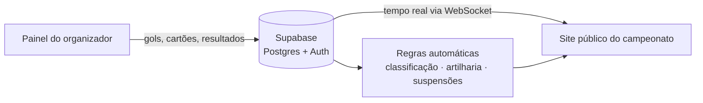

> **🟢 No ar, com cliente pagante (contrato anual para a temporada 2027)**
>
> 🔒 Este é um repositório vitrine: o código-fonte é privado porque o produto é comercial. Aqui estão o problema, a solução, a arquitetura e os resultados. Demonstração técnica sob pedido.

**Veja funcionando:** [Campeonato ao vivo (liga 2T)](https://liga-pro-api.vercel.app/liga-2t)

## O problema

Organizar um campeonato amador costuma depender de planilha e grupo de WhatsApp: a tabela atrasa, ninguém sabe quem está suspenso e o público só descobre o placar depois do jogo.

## A solução

Uma plataforma SaaS em que o organizador lança os eventos da partida e o site público do campeonato se atualiza na hora — classificação, artilharia e suspensões calculadas sozinhas.

## Funcionalidades

- Cadastro de times, jogadores e partidas
- Eventos de partida em tempo real via WebSocket (gols, cartões, placar)
- Tabela de classificação e artilharia geradas automaticamente
- Suspensões automáticas por cartões
- Painel do organizador e site público do campeonato
- Multi-tenant: cada organização com seus próprios campeonatos

## Como funciona

## Stack

| Camada | Tecnologias |
|---|---|
| Front-end | React, TypeScript |
| Back-end e dados | Supabase (Postgres, Auth), WebSocket |
| Arquitetura | Monorepo com pnpm workspaces (apps, packages, infra), multi-tenant |
| Infra e deploy | Docker Compose, Vercel |

## Resultados

- Produto construído e operado sozinho, do zero ao cliente pagante
- Campeonato real rodando na plataforma (liga 2T)

<!-- Para mostrar telas: coloque os prints em ./docs e descomente o bloco abaixo
## Telas

-->

---

Desenvolvido por <b>Wiliam Bonetti</b> · <a href="https://portfolio.wbonetti.com.br">portfólio</a> · <a href="https://www.linkedin.com/in/wiliam-bonetti">linkedin</a> · <a href="https://www.instagram.com/willbonetti">instagram</a> · <a href="mailto:wiliam.bonetti@gmail.com">e-mail</a>

